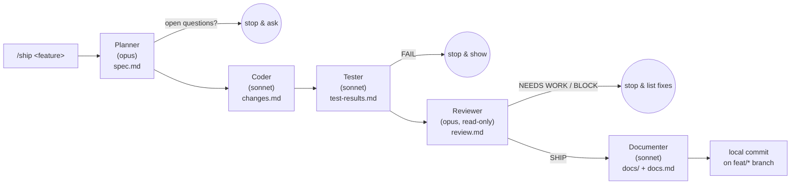

# /ship — a 5-agent feature pipeline for Claude Code

One command takes a feature request through **plan → code → test → review → docs**,
each stage run by a specialist subagent with a clean context, handing off through
files in `.pipeline/`. It ends with a **local commit on a feature branch** — it never
pushes, merges or deploys. You review in the morning.



## Why a pipeline instead of one agent
One agent doing planning, coding, testing and review fills its context until quality
drops. Five specialists each keep a narrow context, and the **handoff file** is the
contract between them.

| Stage | Model | Can edit? | Output |
|---|---|---|---|
| Planner | opus | only its spec | `.pipeline/spec.md` — files, signatures, edge cases, patterns to copy, OPEN QUESTIONS |
| Coder | sonnet | code | code + `.pipeline/changes.md` (starts with "Conventions followed") |
| Tester | sonnet | tests only | tests + `.pipeline/test-results.md` (`RESULT: PASS/FAIL`) |
| Reviewer | opus | **read-only** | `.pipeline/review.md` (`VERDICT: SHIP / NEEDS WORK / BLOCK`) |
| Documenter | sonnet | `docs/` only | OpenAPI spec, feature doc, Mermaid diagrams, `.pipeline/docs.md` |

## Guardrails
- **Feature branch only.** On `main`/`dev`/`release/*` it branches to `feat/<slug>` first.
  It never commits to, merges into, rebases, resets or pushes a protected branch.
  Subagents can't run branch/commit commands at all — only the orchestrator can.
- **Follows your codebase.** The Coder studies 2–3 similar existing features first
  (layering, package layout, naming, DTO/error shapes) and writes them down. No new
  API, controller, service, dependency or abstraction unless the spec requires it;
  the Reviewer marks duplicates as NEEDS WORK.
- **Stops instead of guessing.** Open questions in the spec, failing tests, or a
  non-SHIP verdict all halt the pipeline and come back to you.
- **Docs that match the code.** OpenAPI 3 spec under `docs/openapi/`, a "how it works"
  doc under `docs/features/`, sequence + flow diagrams under `docs/diagrams/`. Any
  non-doc file the Documenter touches is reverted.
- `.pipeline/` is added to `.git/info/exclude`, so handoff files are never committed.

## Install
Also listed (free) on Agensi: https://www.agensi.io/skills/ship-5-agent-feature-pipeline-for-claude-code

```bash
git clone <this-repo> && cd claude-ship-pipeline
./install.sh            # all repos (~/.claude)
./install.sh project    # only the current repo (./.claude)
```
Restart Claude Code, then inside a git repo:
```
/ship add rate limiting to the login endpoint
```

## Tips
- Start with Planner + Coder only; add the other stages once that feels solid.
- Swap models per stage in each agent's frontmatter (`model: opus|sonnet|haiku`).
- Adjust the protected-branch list and docs paths in `skills/ship/SKILL.md`.

## Credits
Based on the Planner → Coder → Tester → Reviewer pattern described by
[@zodchiii](https://x.com/zodchiii/status/2060674246880149900); extended with the
convention-following coder, feature-branch safety, documenter stage and stop gates.

## License
MIT
