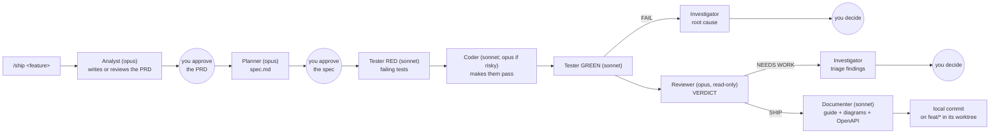

# /ship — a feature pipeline for Claude Code

One command takes a feature request through **requirements → plan → tests first →
code → review → docs**, each stage run by a specialist subagent with a clean context,
handing off through files. It ends with a **local commit on a feature branch** in its
own git worktree. It never pushes, merges or deploys, and it never touches your own
checkout.



A **Quick lane** (`/ship --quick ...`) skips the PRD, planner and approvals for small,
low-risk changes: tests first → code → tests → review (sonnet) → light docs → commit.

## What makes it different
- **Requirements first.** No PRD? The analyst writes one, verified against the real
  code (`path:line`), with testable requirements and open questions answered from how
  similar existing features already work. Have a PRD (`.md`, `.pdf`, `.docx`)? It is
  reviewed against the code instead, and a validation report is saved next to it. A
  PRD the analyst did not write is never overwritten.
- **Tests before code.** The tester writes failing tests from the spec's success
  criteria; the coder makes them pass and may not change them (checksummed).
- **Parallel runs, your checkout untouched.** Every run gets its own git worktree
  per repo (`<repo>-<feature>`, branched from a fresh `origin/dev` or `main`, with no
  upstream) and its own run folder. Start as many runs as you like, from one session
  or several.
- **Multi-repo features.** Start in a folder that holds several repos; the planner
  finds which ones the feature touches and you approve them at the spec gate.
- **Hard guardrails, not just prompts.** Hooks in each agent's definition enforce:
  - a tool guard: read-only git only, no ssh/remote hosts, no publishing or dependency
    installs, no stage/prod profiles or databases, writes only inside the run's
    worktrees (read-only agents cannot write through the shell at all);
  - a stop gate: an agent cannot finish without its handoff file, written during this
    run, with the right status line, and within size limits;
  - an audit log of every allow/deny in the run folder.
- **Deterministic bookkeeping.** Worktrees, snapshots, test checksums, the exact
  commit set and PRD versioning go through `hooks/ship.py`, not through prompts.
- **Developer docs from the final code.** A "how it works" guide (where to start
  reading, how to change and test it, gotchas), Mermaid sequence/flow/ER diagrams and
  the OpenAPI spec, written after review and redone if the code changes again.
- **Per-repo rules.** `<repo>/.ship/constitution.md` (untracked) holds the repo's
  non-negotiables; every agent reads it and confirmed review findings are added as
  lessons.
- **Token-aware.** The orchestrator reads only handoff headers; each agent has its own
  model, effort, turn limit and compaction window; fix rounds are scoped to what
  changed. Start each run in a fresh session.

## Install
Also listed (free) on Agensi: https://www.agensi.io/skills/ship-5-agent-feature-pipeline-for-claude-code

```bash
git clone https://github.com/Altafhossain72/claude-ship-pipeline && cd claude-ship-pipeline
./install.sh      # copies agents, skill and hooks into ~/.claude, then runs the tests
```
Needs `python3` and git 2.25+. Restart Claude Code, then in a fresh session:
```
/ship add rate limiting to the login endpoint
/ship in api and billing: show remaining daily limit on the account summary
/ship --quick in api: fix null pointer when nickname is empty
/ship prd: "PRD - Standing Instructions.md" implement phase 1
```

## Configure
- `~/.claude/ship.json`: `prd_prefix` is how your PRD files are named in the workspace
  (default `PRD - `, e.g. `PRD - Standing Instructions.md`).
- Models, effort and turn limits: each agent's frontmatter in `~/.claude/agents/`.
- Protected branches and lane rules: `~/.claude/skills/ship/SKILL.md`.
- Repo rules: edit `<repo>/.ship/constitution.md` (created on the first run).

After a run, the worktree stays for your review; push from it when you are happy, and
remove it later with `git worktree remove ../<repo>-<feature>`.

## Files
| Path | What |
|---|---|
| `skills/ship/SKILL.md` | the orchestrator (the `/ship` command) |
| `agents/*.md` | analyst, planner, tester, coder, reviewer, documenter, investigator |
| `hooks/ship.py` | run/worktree/snapshot/commit/PRD bookkeeping |
| `hooks/ship-tool-guard.py` | PreToolUse guard for every pipeline agent |
| `hooks/ship-handoff-gate.py` | SubagentStop gate (handoff file, status line, size) |
| `hooks/ship-yaml-check.py` | read-only YAML check for the documenter |
| `tests/hook-tests.sh` | 90 regression cases for the hooks and helper |

## Credits
Started from the Planner → Coder → Tester → Reviewer pattern described by
[@zodchiii](https://x.com/zodchiii/status/2060674246880149900). The `superpowers`
plugin's systematic-debugging and receiving-code-review skills are used by the
investigator when installed.

## License
MIT
